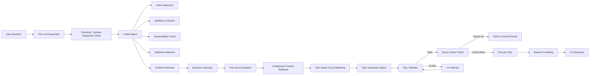
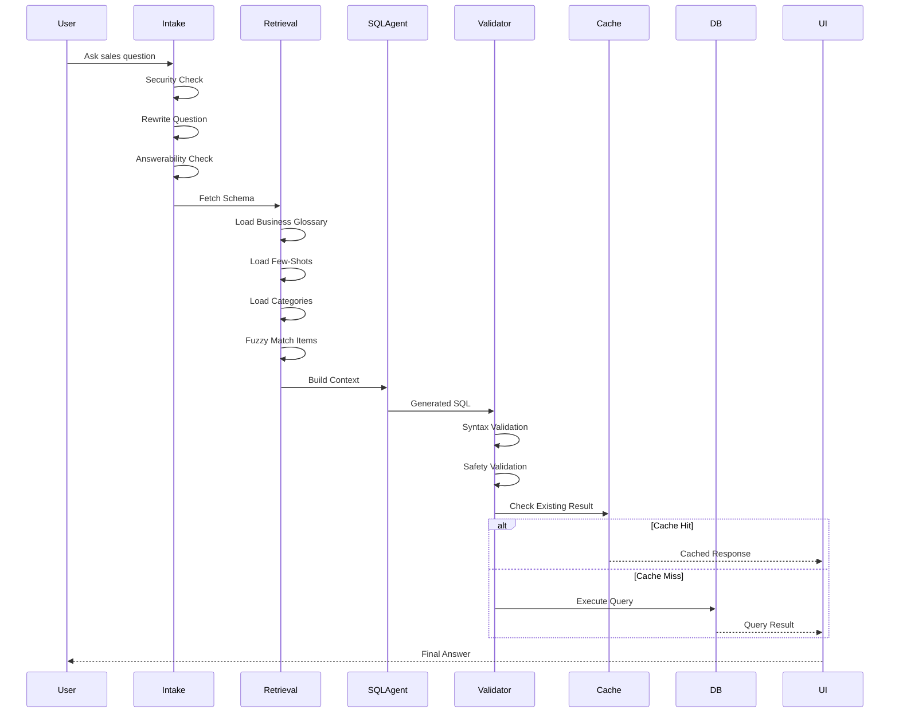
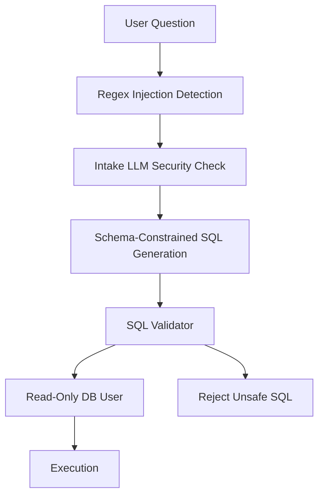

# Petpooja NL-to-SQL Query Generator

## Overview

Petpooja NL-to-SQL is a production-oriented Natural Language to SQL application that converts restaurant sales questions into validated SQL queries against the `pet_pooja_sales` dataset.

The system follows a guarded multi-stage pipeline:

User Question → Intent Analysis → Query Rewrite → Schema Retrieval → Business Glossary → Few-Shot Examples → SQL Generation → SQL Validation → Execution

The current implementation focuses primarily on the query-generation pipeline and validator stage.

---

# Architecture Flow



---

# End-to-End Request Lifecycle



---

# Core Components

## 1. Intake Layer

Responsible for:

* Prompt injection detection
* Jailbreak detection
* Question rewriting
* Spelling correction
* Answerability verification

Output:

```text
{
  rewritten_question,
  is_answerable,
  clarification_needed,
  is_suspicious
}
```

---

## 2. Schema Retrieval

Loads schema information about:

* Table structure
* Column metadata
* Business rules
* Aggregation rules
* Date handling rules

This ensures the model generates SQL using only valid fields.

---

## 3. Business Glossary

Maps business language to database language.

Examples:

| Business Term | Database Meaning |
| ------------- | ---------------- |
| Store         | restaurant_name  |
| Outlet        | restaurant_name  |
| Branch        | restaurant_name  |
| Location      | restaurant_name  |

This helps users ask questions naturally.

---

## 4. Few-Shot Retrieval

Injects curated examples such as:

* Total sales
* Top selling items
* Cancelled orders
* Parcel orders
* Average order value

This improves SQL consistency and reduces hallucinations.

---

## 5. Categorical Context Retrieval

Pulls real values from the database.

Examples:

```text
status:
    Success
    Cancelled

payment_type:
    Cash
    GPay
    Card
```

The model is forced to use actual values instead of inventing them.

---

## 6. Item Name Fuzzy Matching

Handles:

* Typographical errors
* Alternate spellings
* Regional synonyms

Example:

```text
curd
dahi
yogurt
```

All map to the same menu item group.

---

## 7. SQL Generation Agent

Uses:

* Schema
* Business glossary
* Few-shot examples
* Categorical values
* Item matches

to generate SQL.

Supported model cascade:

```text
Primary Model
    ↓
Gemini 2.5 Flash
    ↓
Gemini 2.0 Flash
    ↓
GPT-OSS 120B
    ↓
Qwen 3.6 27B
```

Automatic fallback occurs if a model fails.

---

## 8. SQL Validator

Validates:

### Syntax

* SQL parsing
* Valid SELECT statement

### Security

Blocks:

* UPDATE
* DELETE
* INSERT
* DROP
* ALTER
* TRUNCATE

### Schema Validation

Checks:

* Valid tables
* Valid columns
* Allowed aggregations

---

## 9. Query Cache

SQLite-backed cache.

Cache key includes:

* User question
* Model used
* Categorical context snapshot
* Prompt version

Benefits:

* Lower latency
* Reduced LLM cost
* Consistent responses

---

## 10. SQL Execution

After validation:

```text
Generated SQL
    ↓
Read-only Database User
    ↓
Execution
    ↓
Results
```

Production recommendation:

```text
Never execute with a write-enabled DB account.
Use a dedicated SELECT-only user.
```

---

# Observability

## Logfire

Tracks:

* Request lifecycle
* Cache hits/misses
* Validation failures
* Execution time
* Row counts
* Model selection
* Retry attempts

## Langfuse

Tracks:

* Prompts
* Responses
* Token usage
* Cost
* Latency
* Traces

## The application exports OpenTelemetry traces to both Logfire and Langfuse.

# Production Guardrails



Layers:

1. Regex Guardrail
2. LLM Security Classification
3. Schema-Constrained Generation
4. SQL Validator
5. Read-Only Database User

---

# Current Pipeline Coverage

Implemented:

* Intent Detection
* Rewrite
* Security Checks
* Schema Retrieval
* Business Glossary
* Few-Shot Retrieval
* SQL Generation
* SQL Validation
* Cache
* Execution
* Observability

Future Hardening:

* Result Explanation Agent
* Dashboard Generation
* Chart Recommendation Engine
* Semantic Metric Layer
* RAG-based Business Knowledge Base

---

# Technology Stack

```text
Frontend:
    Streamlit

LLM Framework:
    PydanticAI

Models:
    Gemini
    GPT-OSS
    Qwen

Database:
    MySQL

Validation:
    SQLGlot

Caching:
    SQLite

Observability:
    Logfire
    Langfuse

ORM:
    SQLAlchemy
```

---

# High-Level Summary

```text
User Question
    ↓
Guardrails
    ↓
Rewrite + Intent
    ↓
Schema + Glossary + Few-Shots
    ↓
SQL Generation
    ↓
SQL Validation
    ↓
Cache
    ↓
Execution
    ↓
Results
```

This architecture prioritizes **accuracy**, **security**, **cost control**, **traceability**, and **production readiness** for restaurant sales analytics.
