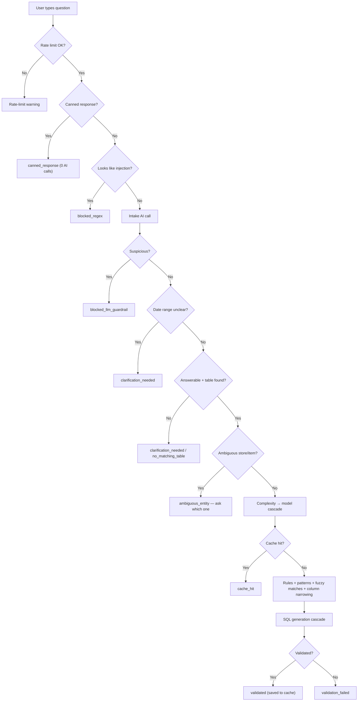

# Chaat Anna — Sales Analytics Assistant (NL → SQL), v2

Ask a question about Chaat Anna sales in plain English — *"What were total sales at Alwarpet last week?"*, *"Which item sold the most in September?"* — and the app writes the SQL, checks it is safe, runs it on the database, shows the result table, and (for "why / compare / trend" questions) explains what the numbers mean.

| | |
|---|---|
| **Program folder** | `/home/tinysync/Documents/CA_NL_SQL/v2/v2` |
| **Virtual environment** | `/home/tinysync/Documents/CA_NL_SQL/venv` |
| **Main file** | `app_nl.py` (Streamlit) |
| **Runs at** | http://91.108.105.87:8034 |
| **Data it queries** | MySQL `CA_reconciliation` → table **`pet_pooja_sales`** (Petpooja invoice lines — the same table the Cash Reconciliation app fills) |

---

## 1. How to run

```bash
# 1. Activate the virtual environment (it lives one folder ABOVE the project)
source /home/tinysync/Documents/CA_NL_SQL/venv/bin/activate

# 2. Go to the project folder
cd /home/tinysync/Documents/CA_NL_SQL/v2/v2

# 3. (first time / after requirements change)
pip install -r requirements.txt

# 4. Start in the background on port 8034
nohup streamlit run app_nl.py --server.port 8034 > nohup.out 2>&1 &
```

**Stop / restart:**
```bash
ps aux | grep "streamlit run app_nl.py"    # find the PID
kill <PID>
# then run step 4 again
```

**Logs:** `tail -f nohup.out`

### Settings (`.env` file in the project folder)

| Key | What it is |
|---|---|
| `GEMINI_API_KEY` | Google Gemini key (SQL generation / reasoning models) |
| `GROQ_API_KEY` | Groq key (fast, cheap models) |
| `LOGFIRE_TOKEN` | Optional — sends traces to Logfire cloud |
| `LANGFUSE_PUBLIC_KEY`, `LANGFUSE_SECRET_KEY`, `LANGFUSE_HOST` | Optional — sends traces to Langfuse |
| `EXEC_DB_URL` | Optional — database to query. If not set, uses `CA_reconciliation` (from `config.py`) |
| `APP_PASSWORD` | Optional — if set, the app asks for this password before opening |

> ⚠️ `.env` holds real API keys. Never share it, zip it or commit it to git.

---

## 2. What happens when you ask a question (simple version)

```
Your question
   │
   ▼
1. Safety check ─────── greeting / small talk → friendly canned reply (no AI cost)
   │                    looks like a hacking attempt → blocked
   ▼
2. Understand ───────── AI rewrites the question clearly, picks the table,
   │                    decides if it also needs an explanation ("why", "compare")
   │                    unclear / ambiguous store or item name → asks you to clarify
   ▼
3. Pick a model ─────── simple question → small, cheap model
   │                    harder question (joins, comparisons) → stronger model
   ▼
4. Cache ────────────── same question asked recently? → reuse the saved answer
   │
   ▼
5. Gather context ───── only the columns, business rules, store/item names and
   │                    example queries THIS question needs (keeps prompts small & cheap)
   ▼
6. Write SQL ────────── AI writes the SQL query
   │
   ▼
7. Validate ─────────── read-only? real columns? invoice duplicates handled?
   │                    business rules followed? ── fails → AI fixes it and tries again
   ▼
8. Run (you click ▶️) ── cost check + row limit, then runs on MySQL
   │                    database error → AI repairs the SQL and retries
   ▼
9. Explain (optional) ─ for "why / compare / trend" questions, AI reads the result
   │                    rows and writes an Analysis: insight, key findings, caveats
   ▼
Result table + Analysis
```

Every step is recorded for monitoring (see section 5).

More detailed diagrams: `FLOW.md` (simple flow), and the sections from the original README are reproduced in **Appendix A**.

---

## 3. Using the app

1. Type a question → **Generate SQL**.
2. Read the **rewritten question** and **assumptions** — this is how the app understood you.
3. Check the **Generated SQL**, then click **▶️ Run this query**.
4. See the **Result** table; for analytical questions, an **🧠 Analysis** box appears below it.

**Sidebar:**
- **🔄 Refresh live values from DB** — reload store / item / payment-type names (use after new stores or items appear).
- **🧹 Forget conversation context** — start fresh (follow-up questions otherwise use earlier context).
- **Registry preview** — shows the tables/rules the app knows.
- **🕘 Query history** — your recent questions.

**AI Observability page** (left menu) — tokens, cost, latency, cache hits, which model was used, success/failure rate.

---

## 4. Folder structure — what is in each folder

```
v2/
├── app_nl.py                     Main Streamlit app — run this. The question box, buttons,
│                                 result table, Analysis box, sidebar.
├── config.py                     All settings: DB connection, the 3 model tiers
│                                 (SIMPLE / MEDIUM / COMPLEX) and their fallbacks,
│                                 retry limits, cache time, app password.
├── .env                          API keys and secrets (never share).
├── requirements.txt              Python packages.
├── FLOW.md                       One-page flow diagram.
│
├── pages/
│   └── 1_AI_Observability.py     Monitoring dashboard (shows up as a 2nd page in the app).
│
├── core/                         ── The backbone ──
│   ├── pipeline.py               Runs steps 1–7 in order for every question; tries the
│   │                             cheapest exit first (canned reply, cache) before calling AI.
│   └── models.py                 Shapes of the data passed between steps
│                                 (intake result, SQL result, reasoning result, business
│                                 rule, SQL pattern, metric definition).
│
├── llm/                          ── Everything that talks to an AI model ──
│   ├── agents.py                 Builds the two main AI helpers: the "intake" helper
│   │                             (understand + rewrite + pick table) and the
│   │                             "SQL writer" helper. Holds their instructions (prompts).
│   ├── reasoning.py              The "Analysis" helper — explains result data in plain
│   │                             words; also turns month numbers into names (1 → January).
│   │                             Sends at most 100 result rows to the AI.
│   ├── guardrail.py              Canned replies (hi / thanks / who are you) and the
│   │                             pattern-based block for prompt-injection attempts.
│   ├── complexity.py             Decides SIMPLE / MEDIUM / COMPLEX by rules (no AI cost).
│   └── model_router.py           Turns that tier into an ordered list of models to try.
│
├── retrieval/                    ── What the AI is allowed to know ──
│   ├── registry.py               THE source of truth: table description, every column and
│   │                             its meaning, "glossary" (store → restaurant_name,
│   │                             payment method → payment_type …), business rules,
│   │                             example query patterns, metric definitions.
│   │                             Also picks only the columns a question needs.
│   └── rule_retrieval.py         Picks the business rules relevant to a question
│                                 (mandatory ones always + keyword-matched ones).
│
├── data/                         ── Database + local storage ──
│   ├── db.py                     MySQL connection; fetches live store/item/payment names;
│   │                             fuzzy matching ("alwarpt" → "Chaat Anna - Alwarpet");
│   │                             spots ambiguous names that need clarifying.
│   └── cache.py                  Saves answered questions (6 hrs) + per-user rate limiting.
│
├── execution/                    ── Running SQL safely ──
│   ├── validator.py              Checks every SQL before it runs: SELECT only, real
│   │                             tables/columns only, invoice de-duplication, name
│   │                             matching done properly, metric logic correct.
│   └── executor.py               Cost check (EXPLAIN), adds a row LIMIT, runs the query,
│                                 and asks the AI to repair it if MySQL returns an error.
│
├── observability/
│   └── observability.py          Sends traces to Logfire / Langfuse and writes one summary
│                                 row per question into the local SQLite log used by
│                                 the dashboard.
│
├── nl2sql_cache.sqlite3          (auto-created) answer cache + rate-limit counters
├── app_nl_observability.sqlite3  (auto-created) monitoring log for the dashboard
└── nohup.out                     (auto-created) app log when run with nohup
```

---

## 5. Monitoring (observability)

- **Logfire / Langfuse** (if keys set) — full detail of every step and every AI call. Logfire project: `nivetha/ca-nl-sql`.
- **Local dashboard** (`AI Observability` page) — reads `app_nl_observability.sqlite3`:
  query history, tokens, cost*, cache-hit ratio, which model answered, latency, success / failure.

\* Cost uses **placeholder prices** in `observability.py` — update `MODEL_PRICING_PER_1K_TOKENS_USD` before trusting the ₹/$ numbers.

---

## 6. Adding a new table (today's way)

Everything is in `retrieval/registry.py` — no other file needs changing:

1. Add the table under `TABLE_REGISTRY` — description, columns with meanings, categorical columns, join keys, `baseline_columns`, and `column_synonyms` (glossary).
2. Add its `BusinessRule` entries (`mandatory=True` only if `validator.py` also checks it).
3. Add `SQLPattern` examples for common question shapes.
4. Add `MetricDefinition` entries for its business metrics.

> If the app says *"column X isn't available"* for a column that exists, it's almost always a missing `column_synonyms` entry.

---

## 7. Known gaps (still open in v2)

1. **Repair step sends the full schema.** `execution/executor.py` calls `sql_agent_builder(...)` without `question=`, so when a query fails in MySQL and is repaired, the AI gets the whole table description instead of the narrowed one → more tokens. Fix: pass `question=rewritten_question`.
2. **Duplicate narrowing code.** `core/pipeline.py` keeps its own `_filter_fuzzy_noise` / `_relevant_columns_by_table` while `retrieval/registry.py` has shared versions; `app_nl.py`'s "Run this query" path doesn't narrow at all. Point both at the `registry.py` versions.
3. **Stale label.** `app_nl.py` still shows *"reasoning engine not built yet — data only"* in the routing label, but `llm/reasoning.py` now exists and runs. Update the label text.
4. **`token_usage_extraction_failed`** appears often in `nohup.out` — token counts (and therefore cost) on the dashboard may be under-reported for some models.

---

## 8. Future improvements

### 8.1 Whole database, with a vector database for schema search
**Today:** the app knows **one table** (`pet_pooja_sales`), described by hand in `registry.py`.

**Next:**
1. **Connect the whole database** (all Chaat Anna tables).
2. **Store every database, table, column and its description in a vector database** (each description saved as an embedding).
3. When a question comes in:
   - convert the question into an **embedding**,
   - **search the vector DB** for the closest tables and columns,
   - send **only those tables and columns** to the AI.
4. Everything after that stays the same — validate → run → repair → explain.

This keeps prompts small and accurate even with dozens of tables (replaces the "pick table" part of the intake step for large schemas).

### 8.2 Mask real data before the Analysis step
**Today:** the Analysis (reasoning) step sends **real result rows** — store names, item names, customer names — to an outside AI model.

**Next:** before sending, **replace categorical values with codes** (e.g. `Chaat Anna - Alwarpet` → `Store_A`, `Pani Puri` → `Item_X`), keep a private lookup table, let the AI reason on the masked data, then **swap the real names back** in the final Analysis shown to the user. Numbers stay as they are; real names never leave our server.

### 8.3 Move to FastAPI and integrate with teams.chaatanna.in
**Today:** a separate Streamlit app on port 8034 with its own optional password.

**Next:**
- Expose the pipeline as **FastAPI** endpoints, e.g.
  - `POST /nl2sql/generate` → question in, rewritten question + SQL + assumptions out
  - `POST /nl2sql/execute` → run the SQL, return rows (+ Analysis when needed)
  - `GET /nl2sql/history`, `GET /nl2sql/observability`
- The `core/`, `llm/`, `retrieval/`, `data/`, `execution/` folders are already separate from the Streamlit screen, so they can be reused almost as-is — mainly `app_nl.py` gets replaced by API routes.
- Add an **"Ask Data"** page inside **teams.chaatanna.in**, using that app's existing **login and user roles** (instead of the shared `APP_PASSWORD`), so access can be limited per role and every question is logged against the real user.

---

## Appendix A — Detailed diagrams (from the original README)

### Request lifecycle — every possible exit



### SQL generation cascade
Each model gets a few attempts (validator error fed back each time); if it still fails, the next model in the tier is tried — bounded by `MAX_SQL_ATTEMPTS_PER_MODEL` and `MAX_SQL_ATTEMPTS_TOTAL` in `config.py`.

| Tier | Primary | Fallbacks |
|---|---|---|
| SIMPLE | groq gpt-oss-20b | groq qwen3.6-27b → gemini-3.1-flash-lite |
| MEDIUM | groq qwen3.6-27b | groq gpt-oss-120b → gemini-2.5-flash |
| COMPLEX (also used for Analysis) | gemini-2.5-flash | groq gpt-oss-120b → gemini-3.5-flash |

### Deliberately deferred (from the original design)
Embedding-based schema retrieval and few-shot retrieval, a dedicated table-selector step, a query planner, a dedicated vector DB, and streaming SQL generation were all postponed until the table count grows — **section 8.1 above is the planned trigger for the first of these.**
